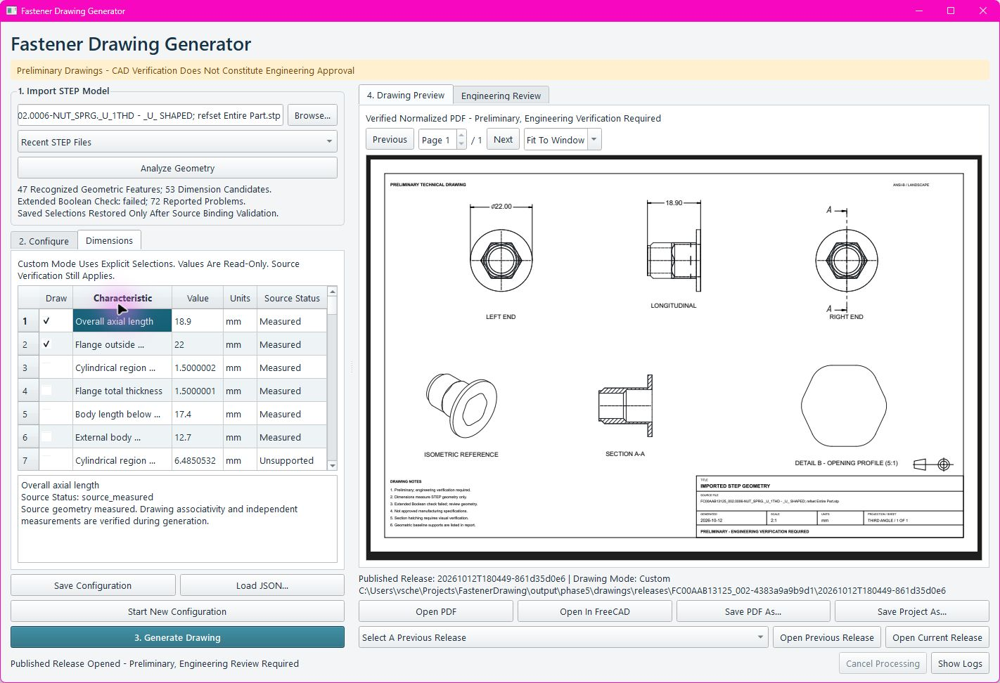
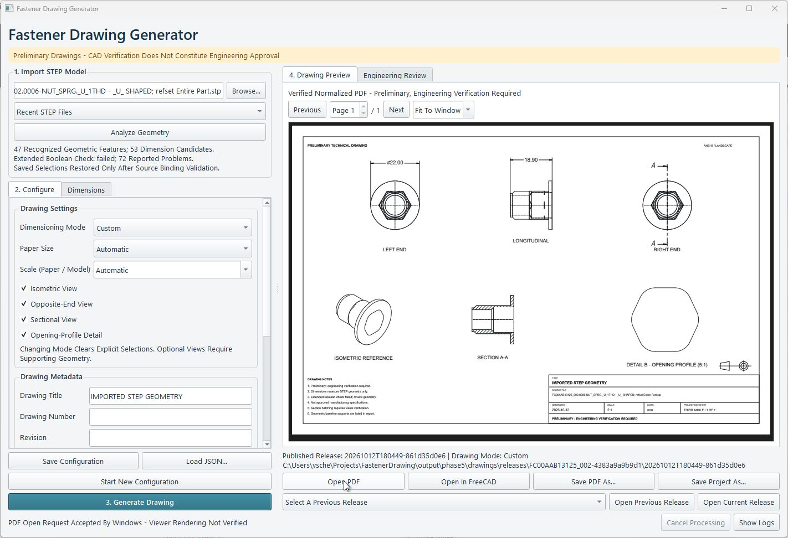

# NutCase
*Because sometimes you've got to examine your nuts from every angle.*

A Windows Python application that analyzes STEP fasteners with FreeCAD and generates preliminary native TechDraw drawings, editable FreeCAD projects, and normalized, independently checked PDFs. Measurements come from CAD geometry. Unsupported feature classifications remain unresolved.

## Desktop application

Double-click **Launch Fastener Drawing.cmd**. Browse a STEP file, analyze it, choose dimensions and views, then generate and review the drawing. Input files may be anywhere; `input/` retains the two supplied example STEP files.

The prepared `.venv-gui` runs the desktop application and PDF processing. FreeCAD's bundled Python runs geometry analysis and native drawing export in separate processes. Keep both environments intact.

See [desktop usage and setup](docs/PHASE5_USAGE.md) for configuration persistence, runtime overrides, cancellation, preview, and exporting PDF/FCStd files.





## Requirements and startup checks

- Windows with a working FreeCAD installation, including its bundled Python, Part and TechDraw APIs.
- External Windows CPython, with `requirements-gui.txt` for the desktop application or `requirements-pipeline.txt` for the command-line pipeline.
- Poppler's `pdftoppm.exe`, available on PATH, through `FASTENER_POPPLER`, or supplied explicitly.

For a new external environment:

```powershell
py -3.12 -m venv .venv-gui
.\.venv-gui\Scripts\python.exe -m pip install -r requirements-gui.txt
```

The existing prepared environment does not contain pip; its update command is documented in the desktop usage guide. Do not install these dependencies into FreeCAD's bundled Python.

FreeCAD is discovered from PATH, uninstall records, and installation directories. Override with `-FreeCADHome` if necessary; no installation path is assumed by the launcher. The observed development installation was FreeCAD 1.1.4, bundled Python 3.11.14 and Open CASCADE 7.8.1.

```powershell
& '.\Launch Fastener Drawing.cmd' -StartupCheck
.\scripts\analyze-step.ps1 -InspectEnvironment
```

`-StartupCheck` probes external dependencies and native FreeCAD, initializes the actual Qt window/event loop, prints `GUI_STARTUP_OK`, and exits without generation or changing saved GUI settings. Shell probes execute a standalone Python file to work under Windows PowerShell 5.1 as well as PowerShell 7.

## Command-line generation

```powershell
.\scripts\generate-fastener.ps1 `
  -InputFile 'input\your-fastener.step' `
  -OutputDirectory 'output\drawings' `
  -Config 'config\comprehensive.json' `
  -PdfPython '.\.venv-gui\Scripts\python.exe' `
  -Poppler 'C:\tools\poppler\Library\bin\pdftoppm.exe'
```

External Python is selected from `-PdfPython`, `FASTENER_PDF_PYTHON`, `.venv-pdf`, then PATH. Poppler is selected from `-Poppler`, `FASTENER_POPPLER`, then PATH. `-FreeCADHome` overrides FreeCAD discovery.

The external-Python entry point is also available:

```powershell
.\.venv-gui\Scripts\python.exe src\entrypoints\generate_fastener.py input\your-fastener.step `
  --freecad-python 'C:\path\to\FreeCAD\bin\python.exe' `
  --poppler 'C:\path\to\pdftoppm.exe' `
  --output-dir output\drawings --config config\basic.json
```

Exit `0` means a preliminary release or catalog was produced; `2` means a complete preliminary release needs geometry/dimension review; `1` means processing failed without publishing a new current release. Neither successful exit is engineering approval.

For analysis only, run `scripts/analyze-step.ps1 -InputFile 'input\your-fastener.step'`. It imports native geometry, checks the source hash, validates each component and writes measured/inferred characteristics to JSON. Assemblies are not reduced to an arbitrary component.

The lower-level `scripts/generate-drawing.ps1` and `src/entrypoints/generate_drawing.py` remain available for native drawing export. Their PDFs are native intermediate exports; use the unified pipeline for automatic compatibility normalization and independent PDF checks. `src/entrypoints/normalize_drawing_pdf.py` provides a separate external-Python repair CLI and JSON audit.

## Drawing configuration

Human-readable examples are in `config/basic.json`, `config/comprehensive.json`, `config/custom-start.json`, and `config/examples/`.

| Field | Meaning |
| --- | --- |
| `dimensioning.mode` | `basic`, `comprehensive`, or `custom` |
| `dimensioning.include`, `.exclude` | Stable geometric candidate identities; exclusion takes priority. An identity in both lists is rejected. |
| `views.isometric`, `.opposite_end`, `.section`, `.opening_detail` | Optional native views. Longitudinal and right-end views are always present. |
| `sheet.size` | `auto`, ANSI A/B/C/D, A3 or A4. Auto begins with ANSI B and enlarges when necessary. |
| `scale` | `auto` or a positive paper/model ratio, e.g. `2` for 2:1. Opening details retain separately verified automatic scales. |
| `orientation.axis`, `.up` | Optional finite three-vectors; up must be perpendicular to the selected axis. |
| `metadata.title`, `.drawing_number`, `.revision`, `.date` | User-supplied title-block fields; date is ISO YYYY-MM-DD or null. |
| `source_binding` | Native geometry fingerprint, source hash and candidate identity set. Preserve this block when editing a saved policy. |

Basic mode prioritizes supported overall length, external diameters, the smallest recognized coaxial bore, across-flats and terminal enlargement geometry. Comprehensive retains the reviewed feature-based selection and redundancy rules. Custom starts with no dimensions and includes only explicit stable identities. Selection does not bypass source, reference, measurement or layout verification.

Prepare an editable source-bound policy with `-CatalogOnly`. Copy the emitted `.config.json`, select `g1-...` identities from its catalog/review, and generate with that saved file. Sequential `D001` labels and projected `EdgeN` indices are not configuration identities.

Regeneration without an explicit configuration reuses the current release's policy. Changed source geometry or missing saved identities block incompatible selections; they are not guessed or silently remapped. `-FreshConfig` explicitly starts with defaults. The GUI restores compatible policies only after fresh analysis, and archives previous policies when a fresh save replaces them.

## Outputs and safe publication

Each output directory contains immutable complete releases under `releases/<part key>/<run id>/`. A `<STEP stem>.current.json` manifest records the current release and SHA-256 hashes of its deliverables: normalized PDF, FCStd, analysis, catalog, configuration, drawing report, coverage and engineering review, normalization/verification records, and renderer previews.

The GUI validates every recorded artifact before previewing or exporting. A failed or cancelled job clears the preview while keeping the previous complete release. Exported copies are also checked against published hashes.

`runs/<run id>/native/` retains the original native PDF and CAD export for troubleshooting. PDF normalization stays outside FreeCAD; Poppler and PDFium independently render and compare the corrected PDF. New outputs retain diagnostics automatically.

The atomic manifest replacement is the publication commit. Failed export, normalization or verification cannot replace a valid current drawing. An interrupted run can leave diagnostics, an unreferenced complete candidate, or a stale `.generation.lock`; inspect its PID and run before removing a stale lock. Generation never steals a lock.

Saved GUI settings and configurations live under `output/gui-state/`. The currently configured drawing directory is recorded in `settings.json`. Project-local `tmp/` holds disposable launcher inspections and isolated batch FreeCAD preferences and is recreated as needed.

## Engineering limits and report interpretation

Every drawing is **preliminary and requires engineering verification**. The source STEP is preserved. No nominal dimensions, tolerances, materials, finishes, thread designations or GD&T are assigned automatically.

The two supplied models retain extended Boolean-validation problems. Valid measured dimensions do not establish that the source solid is suitable for manufacturing. Hatching must correspond to verified original solid material; the second sample retains its documented native section-face conversion limitation and verified-boundary fallback.

Source binding is conservative: pose, trim, topology or importer changes may require manual review. Synthetic fixtures and two supplied samples do not establish generalization across fastener families. Default-system-viewer rendering and physical multi-monitor DPI switching remain separate from embedded PDF verification.

Reports contain source hashes, runtime details, whole-model validation and bounding box, plus one analysis per solid. Assemblies are not reduced to the largest solid or interpreted as a single fastener. Surface-only input produces a diagnostic envelope and a review warning.

Each component separates:

- `geometry`: direct BRep measurements, surface inventory, candidate axes, aligned envelope, cylindrical bands and external hexagonal supporting-plane spacings.
- `recognition`: inferred feature roles, recognized dimensions with supporting face references, unrecognized dimensions with `value_mm: null`, thread appearance and manual-review notes.
- `validation`: native basic validity, detailed BRep check, extended Boolean check, solid closure/volume and diagnostic text.
- `feature_discovery`: Phase 3 geometric features, source supports, generalized candidates and recognition limits, separate from semantic fastener roles.

Lengths use FreeCAD's native millimeter convention; the STEP reader handles file units. Area and volume are explicitly tagged `mm2` and `mm3`. Both supplied STEP files declare millimeter units. Surface UV parameter bounds are native parameters, with units depending on the surface.

The global bounding box follows world XYZ and depends on orientation. It is not a fastener length. A model copy is rigidly transformed into a frame whose Z direction follows the selected native axis, without modifying the source shape or STEP file. Axial extent is measured from that copy with `optimalBoundingBox(False, False)`, disabling triangulation and requested shape-tolerance inflation.

Axis selection uses the dominant common centerline of analytic cylinders/cones, rejecting competing support. A regular prism without curved faces can use a distinct principal inertia axis only when two other moments agree and planar end faces support it. The longitudinal *role* of the common geometric axis is an inference. Axis sign is arbitrary and does not identify a head end.

Face and edge indices are one-based within a solid component in the current import. They are tied to the recorded input hash and reader version, and are not persistent names guaranteed across different CAD importers or releases.

The JSON retains numerical floating-point values. Extra decimal places are computational detail, not a claim of manufacturing accuracy. `max_brep_tolerance_mm` is imported kernel geometry metadata. The geometry-matching thresholds are algorithm settings. Neither is an assigned engineering tolerance.

## Recognition rules and current limits

- Cylinders are measured from their native radius and trimmed axial extent. Split circular faces can form a complete band only when angular coverage and surface area support that conclusion. Internal/external classification uses the oriented native surface normal.
- Cones report their reference radius, semi-angle, apex, native trimmed axial extent and analytic radius range. A cone's reference radius is not promoted to a head diameter.
- External hexagonal regions require six supporting planes with common axial overlap, equal offsets, three opposite pairs and 60-degree normal spacing. Their measured spacing does not establish that the region is a head.
- A headed shaft needs one unambiguous terminal enlarged circular/hexagonal region, a complete circular shaft extending to the opposite end, and a circular junction at a bearing shoulder. Hollow bodies decline these head/shank roles. Chamfered/filleted/complex heads, recessed drives and partial/threaded shafts may be left unrecognized by these initial rules.
- A flange-like measurement requires a thin complete circular enlargement, an annular shoulder, and a narrower coaxial body. The current semantic rule accepts this generic role on hollow bodies when a competing headed-shaft classification is absent. Other flange/head combinations remain unresolved.
- Apparently explicit external threads need repeated compatible native helical curves at different radii, a shared nonanalytic flank face, and a continuous solid shaft core. Native curves are sampled solely for classification diagnostics; fitted pitch/radius are not drawing dimensions. Seam-split curves can be joined into repeated chains. A thread-major diameter is reported only when an analytic cylindrical crest supplies it.
- Smooth bores/shafts cannot prove simplified threading. Without sufficient thread evidence, status is `cannot_determine`. This implementation does not emit `simplified` merely because helices were not found. STEP cosmetic/semantic thread annotations, internal threads, short threads, conical threads and faceted threads require manual review.
- Threaded length remains unrecognized where nominal endpoints and runout cannot be established. No thread designation, pitch specification or standard size is guessed.

Basic invalid/open/zero-volume geometry blocks recognized dimensions. An extended Boolean failure is retained separately; measurements on otherwise valid analytic geometry may be reported, with mandatory geometry-quality review. This is not a clean bill of health for the solid.

## Program layout

| Directory/file | Purpose |
| --- | --- |
| `Launch Fastener Drawing.cmd` | Windows desktop launcher |
| `src/fastener_gui/` | Desktop controls, saved state, worker management, preview and verified export |
| `src/fastener_analysis/` | Native STEP import, validation, geometry and conservative recognition |
| `src/fastener_drawing/` | Configuration, TechDraw views/dimensions, material checks, layout, export and PDF pipeline |
| `src/entrypoints/` | Python command-line entry points, internal workers and dependency probes |
| `src/fastener_paths.py` | Shared source, entry-point and project-data locations |
| `scripts/` | Windows PowerShell launchers |
| `config/` | Editable drawing policies and source-bound examples |
| `input/` | Original supplied example STEP files |
| `output/` | Saved GUI state, current verified releases and their native diagnostics |
| `.venv-gui/` | Installed external Python and GUI/PDF dependencies |
| `docs/` | Usage instructions and screenshots |

All Python application source lives under `src/`. Direct Python commands use `src/entrypoints/`; the root desktop launcher and PowerShell commands remain the same. A small entry-point bootstrap exposes the source packages to both external Python and FreeCAD's bundled interpreter without installing the application into either environment. `fastener_paths.py` resolves paths from its own location, so working-directory changes do not redirect settings, configuration or output defaults into `src/`.

Development regression suites, synthetic fixtures and historical investigation artifacts were removed during the requested directory cleanup. This runtime-focused directory retains the generation pipeline's automatic measurement, reference, reopen, PDF and publication verification gates.

The `src` refactor was validated on 2026-10-12 through the actual Windows batch startup route (also from another working directory), Windows PowerShell 5.1 catalog generation, and the GUI's real QProcess generation pipeline for FC00AAB13125. Its 23 dimensions passed native reopen, reference and measurement checks; PDF normalization, both independent renderer checks and Qt PDF rendering passed. Exit 2 retained the existing geometry-review requirement. Original STEP files, saved GUI state and existing current manifests/releases passed integrity checks. These were runtime checks; the removed historical regression suites were not rerun.
